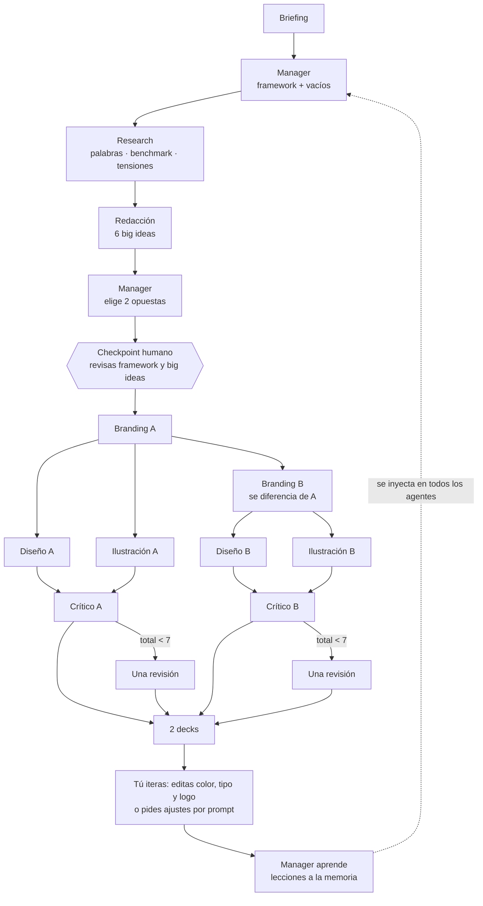

# Fábrica de conceptos · Sistema de agentes

> Diseño es estrategia. Este sistema no genera logos: cocina un concepto y lo traduce a una **dirección visual** que un diseñador humano termina de pulir.

## 1. Qué produce

Para cada briefing produce **dos propuestas** de identidad visual. Cada una nace de una **big idea** distinta (ej. Coca-Cola: "Felicidad en una botella" vs. "Momentos en familia") y cubre:

| Pieza | Qué contiene |
|---|---|
| Concepto | Big idea, tagline, insight, concepto narrado y su conexión con el framework |
| Personalidad | 5 ejes (Rebelde↔Conservadora, Moderna↔Clásica, Cálida↔Fría, Lúdica↔Seria, Popular↔Exclusiva), arquetipo, tono |
| Moodboard | Palabras sensoriales, texturas, dirección de fotografía, composición, 3 referencias reales con búsquedas |
| Logotipo | Símbolo SVG + wordmark (texto, peso, tracking, disposición) + racional |
| Tipografía | Display + texto, del catálogo de Google Fonts, con su porqué |
| Color | 5 colores con rol fijo: primario, secundario, acento, oscuro, claro |
| Íconos y assets | Set de 6 íconos coherentes, patrón de marca, 3 aplicaciones (tarjeta, post, letrero) |

Todo se apoya en el **framework de marca** del estudio (atributos, visión, misión, productos/servicios, target, competidores, propuesta de valor, stakeholders, ventaja competitiva y big idea).

## 2. El equipo

| Agente | Especialidad | Entrada | Salida |
|---|---|---|---|
| **Manager** | Dirige, decide y aprende | Briefing · candidatas · señales del humano | Framework · selección de 2 big ideas · lecciones |
| **Benchmark y research** | Estratega | Framework | Exploración de palabras, benchmark, tensiones, territorios |
| **Redacción creativa** | Copy publicitario | Framework + research | 6 big ideas candidatas |
| **Dirección de branding** | Universo visual | Big idea (+ la otra propuesta) | Personalidad, moodboard, tipografía, color |
| **Diseño gráfico** | Identidad | Big idea + branding | Logotipo, patrón, aplicaciones |
| **Ilustración** | Sistema de íconos | Big idea + branding | 6 íconos y su estilo |
| **Crítico (QA)** | Director creativo | Propuesta + chequeos medidos | Puntaje con rúbrica y, si hace falta, un pedido de revisión |

Definiciones completas de cada rol: [`.claude/agents/`](../.claude/agents/).

## 3. El flujo

**Fase 1 · Estrategia** (Manager → Research → Redacción → Manager). Termina en un *checkpoint humano*: el sistema se detiene para que revises el framework y las big ideas antes de gastar esfuerzo en lo visual. Esto refleja el principio del estudio: primero se cocina el concepto.

**Fase 2 · Identidad** (Branding → Diseño + Ilustración → Crítico). Branding de la propuesta B recibe las decisiones de A para diferenciarse a propósito.

**Fase 3 · Iteración humana**. Cada propuesta se ajusta por separado: paneles de color, tipografía y logotipo en vivo, y un campo de prompt que pasa por el agente de branding con todo el contexto. Cada cambio guarda la versión anterior.

**Fase 4 · Aprendizaje**. Calificas, eliges favorita, y el Manager destila lecciones.

## 4. El harness

El *harness* es todo lo que rodea al modelo para que trabaje bien: qué lee, en qué formato responde, quién revisa y qué se recuerda. Explicación didáctica aparte: ver el documento "Cómo funciona el harness".

| Pieza | Cómo está implementada |
|---|---|
| **Prompt de estudio (mindset)** | Un bloque fijo que todos los agentes leen primero: diseño es estrategia, cocinar antes de plasmar, dirección y no acabado, honestidad con las hipótesis. |
| **Contratos de salida** | Cada agente responde JSON con una forma fija. El harness **normaliza** cada respuesta: completa campos faltantes, fuerza 5 colores en orden de rol, rechaza tipografías fuera del catálogo. |
| **Herramientas de verdad** | Lo que se puede medir no se le pregunta al modelo: contraste WCAG, validez del SVG, número de formas del símbolo, tipografías repetidas entre propuestas. Esas mediciones se le entregan al crítico. |
| **Sanitizador de SVG** | El SVG del modelo se trata como dato: se reconstruye desde una lista blanca de elementos y atributos. Los colores se expresan por rol (`c1`…`c5`), por eso al editar un color cambia todo el sistema. |
| **Bucle de calidad** | Crítico con rúbrica (coherencia, originalidad, diferenciación, ejecución). Si el total es menor a 7 pide **una** revisión de **una** pieza. Una sola vuelta: evita bucles infinitos y costos. |
| **Checkpoint humano** | Pausa obligatoria (desactivable) entre estrategia e identidad. |
| **Memoria** | Lista de hasta 20 lecciones (`preferencia`, `evitar`, `proceso`) que se inyecta al inicio de cada agente. |
| **Historial** | Hasta 15 versiones por propuesta; cualquier versión se puede restaurar. |
| **Trazabilidad** | Bitácora con qué agente trabajó, cuánto tardó y qué decidió el harness. |

## 5. Cómo mejora con cada briefing

Seamos precisos: **el modelo no se reentrena**. Lo que mejora es el **contexto** que el harness le da. Es aprendizaje por memoria, no por entrenamiento.

Las señales que usa el Manager, de más a menos fuertes:

1. **Ediciones manuales**: si cambiaste el acento de `#FF2E88` a `#E0306E`, eso es una corrección directa.
2. **Ajustes por prompt**: lo que tuviste que pedir es lo que el sistema no entregó solo.
3. **Calificación y favorita**: qué dirección ganó y por qué (tus notas).
4. **Puntaje del crítico**: contraste entre el juicio automático y el tuyo.

Con esas señales el Manager reescribe la memoria completa (fusiona, actualiza las que se contradicen, máximo 20). Puedes ver, borrar o escribir lecciones a mano en la pestaña **Memoria del estudio**.

Riesgos conocidos y cómo se controlan:

- *Memoria que se vuelve ruido*: tope de 20 lecciones y fusión obligatoria.
- *Sobreajuste a un cliente*: la instrucción pide lecciones generalizables; las específicas de una marca se descartan.
- *Lecciones equivocadas*: todas son visibles y borrables.

Para medir si de verdad mejora, usa [`evals/rubrica.md`](../evals/rubrica.md): corre el mismo briefing de referencia cada cierto número de proyectos y compara puntajes.

## 6. Dos formas de correrlo

| | App (artifact en claude.ai / escritorio) | Claude Code (este repositorio) |
|---|---|---|
| Uso | Visual: subes el briefing y ves los decks | Archivos: `/fabrica briefs/mi-marca.md` |
| Edición en vivo | Sí: color, tipografía, logo, prompts | No; edita los JSON o pide cambios |
| Benchmark | Conocimiento del modelo, marcado como hipótesis | **Búsqueda web real** con fuentes |
| Memoria | En tu cuenta (privada) | `memoria/aprendizajes.md` (versionada en git) |

La app exporta el proyecto (.json) y la memoria (.md) para pasar de una a otra.

## 7. Límites honestos

- El logotipo es **dirección**, no arte final: símbolos geométricos simples en SVG. El refinamiento (curvas, kerning óptico, construcción) es trabajo humano.
- El moodboard no trae imágenes de internet (la app no puede cargarlas). Compone color, tipografía, texturas y símbolo, y te da búsquedas reales para Pinterest, Behance y Unsplash. Puedes subir tus propias imágenes.
- El benchmark dentro de la app no navega la web. La versión de Claude Code sí.
- Las tipografías se limitan a un catálogo de Google Fonts verificado para evitar fuentes inventadas.
